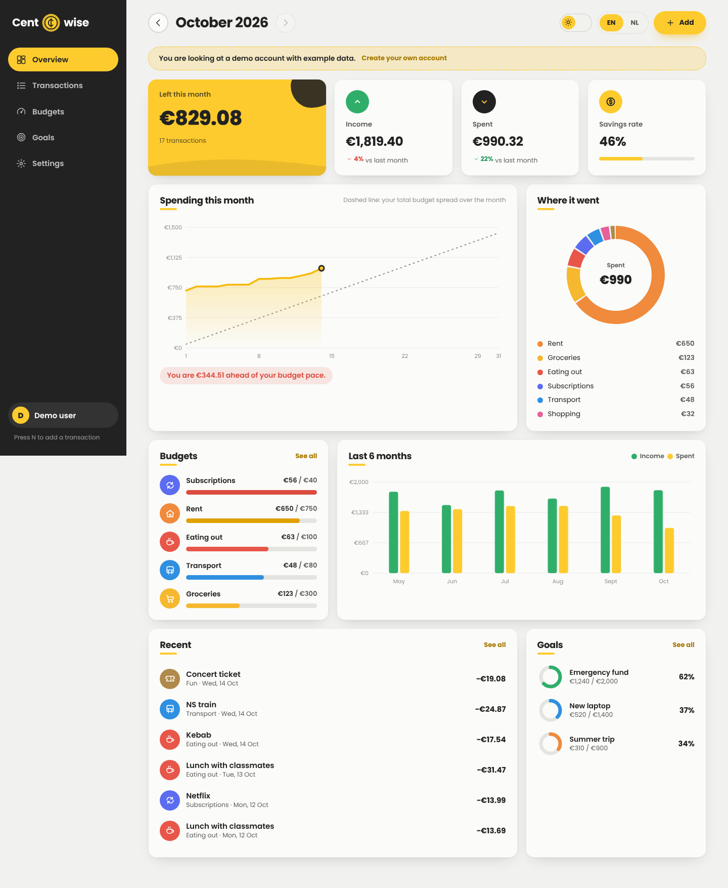
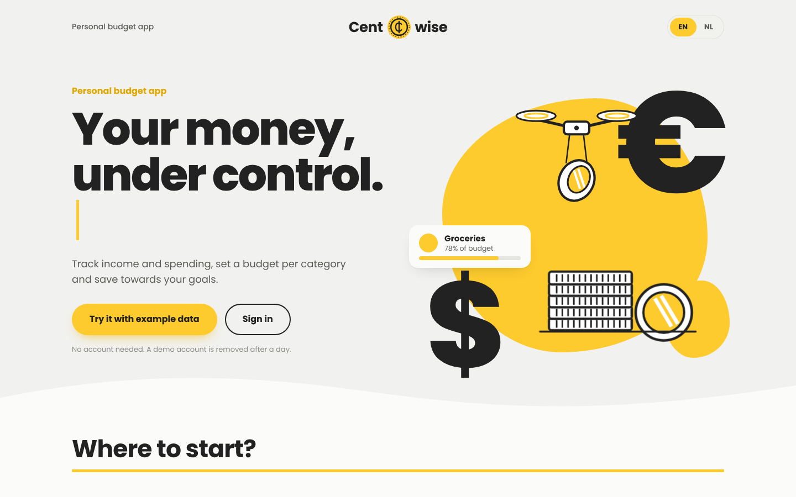
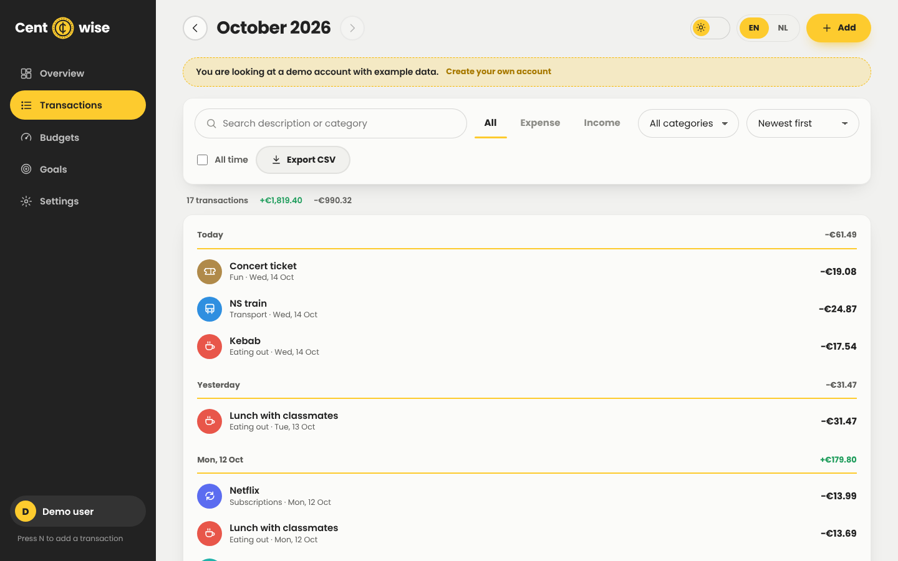
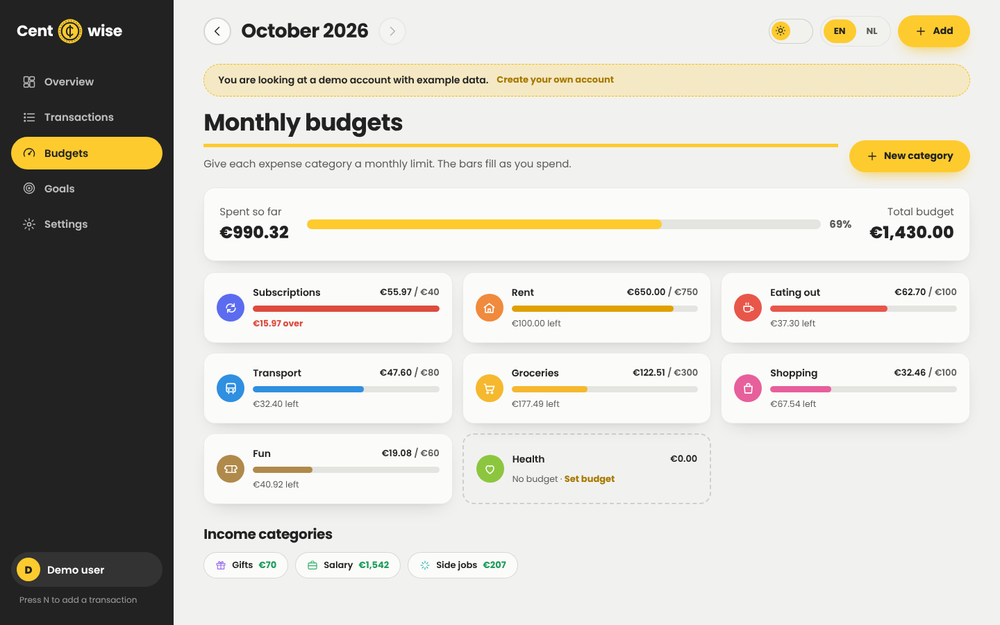
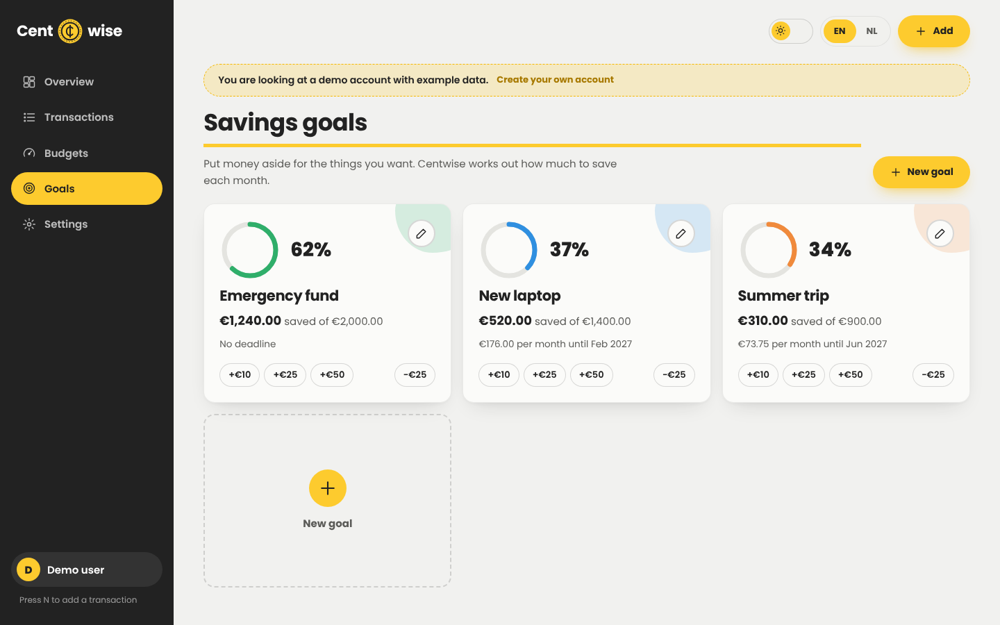
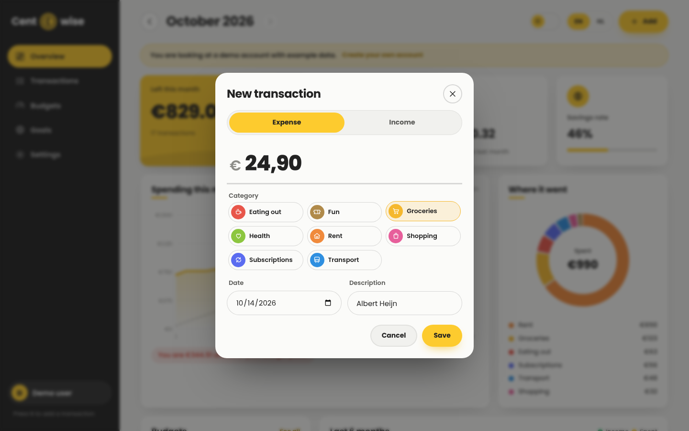
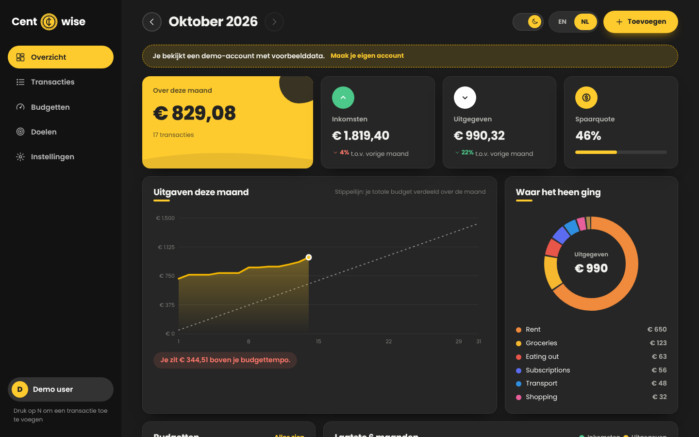
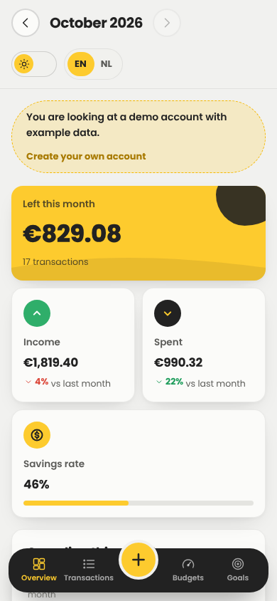

# Centwise

A personal budget app built as a **Laravel REST API** with a **JavaScript dashboard** on top of it. Track income and spending, give every category a monthly budget, follow your spending pace through the month and save towards goals. The interface switches between English and Dutch, and between a light and a dark theme.

[](https://github.com/AhmetR42/centwise/actions/workflows/ci.yml)



## Features

- **Overview per month**: what is left, income, spending and savings rate, each compared with the month before.
- **Spending pace chart**: your running total for the month against your total budget spread evenly over the days, so you see early when you are spending too fast.
- **Where it went**: a ring chart of spending per category, and income against spending for the last six months.
- **Monthly budgets**: a limit per expense category. Bars turn orange near the limit and red when you go over, and you get a warning the moment a new expense pushes a category over budget.
- **Transactions**: search, filter by type and category, sort by date or amount, group by day, edit, delete with undo, and export to CSV (opens in Excel).
- **Categories**: your own names, colours and icons. Every new account starts with eleven common ones, in English or Dutch.
- **Savings goals**: target, deadline and progress ring. Centwise works out how much to put aside per month. Add or take out money with one click.
- **Try without an account**: "Try it with example data" creates a temporary demo account with six months of realistic transactions. Demo accounts are removed after a day.
- **Extras**: animated EN/NL and light/dark switches, keyboard shortcut <kbd>N</kbd> for a new transaction, a phone layout with a bottom tab bar, and a setting that turns animations down.

| Landing page | Transactions |
| --- | --- |
|  |  |
| **Budgets** | **Savings goals** |
|  |  |
| **New transaction** | **Dark theme, in Dutch** |
|  |  |

<p align="center"></p>

## Tech stack

| Part | Choice |
| --- | --- |
| Backend | PHP 8.3, Laravel 13, Laravel Sanctum (API tokens) |
| Database | SQLite (amounts stored as whole cents) |
| Frontend | Plain JavaScript modules, hand-made SVG charts, CSS (no build step) |
| Tests | PHPUnit feature and unit tests, Node's built-in test runner for the frontend helpers |
| Tooling | Docker, GitHub Actions CI, Laravel Pint |

## Getting started

### Option 1: Docker

```bash
git clone https://github.com/AhmetR42/centwise.git
cd centwise
docker compose up --build
```

Open http://localhost:8000 and press **Try it with example data**, or log in with the seeded account `demo@centwise.test` / `password`.

### Option 2: Online (free)

[](https://render.com/deploy?repo=https://github.com/AhmetR42/centwise)

The repository contains a `render.yaml`, so Render builds the Docker image and gives the app a public address. On the free plan the app sleeps after a while without visitors (the first visit then takes about a minute) and the database starts fresh after every restart.

### Option 3: Local PHP

You need PHP 8.3+ with the SQLite extension, and Composer.

```bash
composer install
cp .env.example .env
php artisan key:generate
touch database/database.sqlite
php artisan migrate --seed
php artisan serve
```

## The API

Every screen in the dashboard uses the same JSON API, so it can also be used from another app or from Postman. All endpoints live under `/api/v1`. Except for the three auth routes, they need a token in the header: `Authorization: Bearer <token>`.

| Method | Endpoint | What it does |
| --- | --- | --- |
| POST | `/auth/register` | Create an account (`name`, `email`, `password`, `password_confirmation`, optional `locale`: `en` or `nl`) and get a token |
| POST | `/auth/login` | Get a token for an existing account |
| POST | `/auth/demo` | Create a demo account filled with example data |
| POST | `/auth/logout` | Revoke the current token |
| GET / PATCH / DELETE | `/me` | Read or update your profile (`name`, `currency`), or delete the account |
| GET / POST | `/categories` | List (optional `type`) or create categories |
| GET / PATCH / DELETE | `/categories/{id}` | Read, update or delete one. Deleting a category that is in use answers `409` unless you add `?with_transactions=1` |
| GET / POST | `/transactions` | List with `month=YYYY-MM`, `type`, `category_id`, `q`, `sort` (`newest`, `oldest`, `highest`, `lowest`), `per_page` and `page`, or create one |
| GET / PUT / DELETE | `/transactions/{id}` | Read, update or delete one |
| GET | `/transactions/export` | The same filters, as a CSV download |
| GET / POST | `/goals` | List or create savings goals |
| GET / PATCH / DELETE | `/goals/{id}` | Read, update or delete one |
| POST | `/goals/{id}/deposit` | Add money to a goal, or take it out with a negative `amount` |
| GET | `/stats/summary?month=YYYY-MM` | Totals, comparison with the month before, spending per category against its budget, and spending per day |
| GET | `/stats/trend?months=6` | Income and spending per month |

Example:

```bash
TOKEN=$(curl -s -X POST http://localhost:8000/api/v1/auth/demo -H 'Accept: application/json' | jq -r .token)

curl -s http://localhost:8000/api/v1/stats/summary -H "Authorization: Bearer $TOKEN" | jq '{income, expense, balance}'

curl -s -X POST http://localhost:8000/api/v1/transactions \
  -H "Authorization: Bearer $TOKEN" -H 'Content-Type: application/json' -H 'Accept: application/json' \
  -d '{"category_id": 5, "amount": 12.50, "occurred_on": "2026-10-14", "description": "Lunch"}'
```

Amounts are sent and returned as decimal numbers (`12.5`) and stored as whole cents, so there are no rounding errors. You only ever see your own data: asking for someone else's transaction, category or goal answers `404`. Validation errors come back as `422` with a message per field, and login attempts are rate limited.

## Running the tests

```bash
php artisan test                      # API tests
vendor/bin/pint --test                # code style
node --test public/js/tests/*.test.js # frontend helpers and EN/NL texts
```

GitHub Actions runs all three on every push, then builds the Docker image and checks that the container starts and can create a demo account.

## Project structure

```
app/
  Http/Controllers/Api/   Auth, categories, transactions, goals and statistics
  Http/Requests/          Validation for categories, transactions and goals
  Http/Resources/         JSON output of every model
  Models/                 User, Category, Transaction, Goal
  Support/                Money (cents), starter categories, demo data
database/                 Migrations, factories and the seeder
public/js/
  app.js                  The dashboard: views, dialogs, filters, settings
  api.js                  Small fetch wrapper that adds the token
  charts.js               SVG charts: spending pace, ring, monthly bars, goal rings
  format.js               Money, dates and months in English or Dutch
  i18n.js                 All interface text in English and Dutch
  icons.js                Line icons
public/css/app.css        All styling, both themes and the animations
resources/views/          The single page and its illustration
tests/                    PHPUnit tests
```

## Ideas for later

- Recurring transactions that add themselves every month
- Import a CSV export from a Dutch bank
- Shared budgets for a household

## License

MIT
